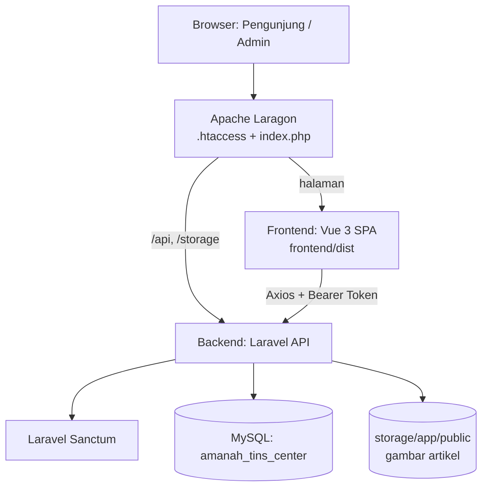

# Dokumentasi, Analisis Kekurangan & Saran
## Amanah Tin's Center — Website & Portal Admin Klinik Tumbuh Kembang Anak

> Terakhir diperbarui: 14 Oktober 2026. Isi dokumen ini telah diverifikasi terhadap kode saat ini
> (menggantikan versi lama yang sebagian temuannya sudah diperbaiki).

---

## Daftar Isi
1. [Ringkasan Proyek](#1-ringkasan-proyek)
2. [Arsitektur & Teknologi](#2-arsitektur--teknologi)
3. [Struktur Direktori](#3-struktur-direktori)
4. [Halaman Publik](#4-halaman-publik)
5. [Portal Admin](#5-portal-admin)
6. [Backend API](#6-backend-api)
7. [Skema Database](#7-skema-database)
8. [Alur Data Penting](#8-alur-data-penting)
9. [Menjalankan Proyek](#9-menjalankan-proyek)
10. [Status Integrasi Data (Dinamis vs Statis)](#10-status-integrasi-data-dinamis-vs-statis)
11. [Kekurangan yang Ditemukan](#11-kekurangan-yang-ditemukan)
12. [Saran & Roadmap Perbaikan](#12-saran--roadmap-perbaikan)
13. [Riwayat Perbaikan Terkini](#13-riwayat-perbaikan-terkini)

---

## 1. Ringkasan Proyek

**Amanah Tin's Center (ATC)** adalah website profil sekaligus sistem informasi klinik tumbuh kembang anak
yang melayani Terapi Wicara, Terapi Okupasi, Sensori Integrasi, dan Fisioterapi/Psikologi Anak.

Proyek terdiri dari dua bagian:
- **Website publik** untuk orang tua: profil klinik, layanan, tim terapis, artikel edukasi, panduan pendaftaran.
- **Portal admin** untuk pengelola klinik: dashboard, kelola artikel, kelola tim, dan pengaturan klinik.

**Keputusan produk penting:** pendaftaran/konsultasi **diarahkan langsung ke WhatsApp**. Fitur janji temu
(appointments) di backend dan halaman admin **sengaja dinonaktifkan** (route dikomentari, data lama tetap
aman di tabel `appointments`).

---

## 2. Arsitektur & Teknologi



| Lapisan | Teknologi |
|---|---|
| Frontend | Vue 3 (Composition API, `<script setup>`), Vite, Vue Router 4, Pinia, Axios |
| Styling | CSS kustom (scoped per komponen), font Outfit & Nunito Sans, Material Symbols |
| Backend | Laravel (REST API), Laravel Sanctum (token), Eloquent ORM |
| Database | MySQL |
| Server lokal | Laragon (Apache); `index.php` + `.htaccess` di root sebagai router universal |

Tema desain: *"Warm Child Development Sanctuary"* — Teal `#006384`, Olive Green `#4b6716`, nuansa hangat ramah anak.

---

## 3. Struktur Direktori

```
AmanahTinsCenter/
├── index.php, .htaccess          # Router root: arahkan /api & /storage ke Laravel, sisanya ke frontend/dist
├── backend/                      # Laravel
│   ├── app/Http/Controllers/Api/ # Article, Auth, Dashboard, Setting, Team, Appointment (nonaktif)
│   ├── app/Models/               # Article, TeamMember, Appointment, ClinicSetting, User
│   ├── database/migrations|seeders
│   └── routes/api.php
├── frontend/src/
│   ├── views/                    # Halaman publik (+ views/admin/ untuk portal admin)
│   ├── components/               # TheNavbar, TheFooter, WhatsAppWidget, dll.
│   ├── composables/              # useClinicSettings, useBookmarks, useActiveSection
│   ├── layouts/                  # PublicLayout, AdminLayout
│   ├── stores/auth.js            # Pinia: sesi admin
│   ├── services/api.js           # Axios + interceptor token & 401
│   └── router/index.js           # Rute + auth guard
├── stitch_blueprint_website_implementation/  # Blueprint desain awal
└── DOKUMENTASI_*.md, PANDUAN_UI_UX_HALAMAN_PUBLIK.md, README.md
```

---

## 4. Halaman Publik

| Rute | View | Isi | Sumber Data |
|---|---|---|---|
| `/` | `HomeView` | Hero, pilar terapi, profil pendiri, layanan, tim, artikel terbaru, kontak | Artikel dari API; sisanya statis |
| `/tentang-kami` | `AboutView` | Visi, misi, nilai, sejarah, fasilitas | Statis |
| `/layanan` | `ServicesView` | Katalog program terapi | Statis |
| `/layanan/:slug` | `ServiceDetailView` | Indikasi, tahapan asesmen, paket biaya, FAQ | Statis |
| `/tim-kami` | `TeamView` | Profil terapis, filter kategori, pencarian, modal detail | **API `/team`** dengan fallback lokal |
| `/artikel` | `ArticlesView` | Katalog artikel, filter, pencarian, bookmark | API |
| `/artikel/:slug` | `ArticleDetailView` | Baca artikel, progress bar, share, bookmark, artikel terkait | **API `/articles/{slug}`** dengan fallback demo |
| `/jadwal-pendaftaran` | `ScheduleView` | Panduan pendaftaran & jam operasional | Statis + WhatsApp |

Komponen lintas halaman: `TheNavbar`, `TheFooter`, `WhatsAppWidget` (nomor WA, alamat, dan jam buka diambil dari
pengaturan klinik lewat `useClinicSettings`), serta bookmark artikel berbasis `localStorage` (`useBookmarks`).

---

## 5. Portal Admin

Semua rute `/admin/*` (kecuali `/admin/login`) dilindungi *route guard* (`meta.requiresAuth`).

| Rute | Fungsi |
|---|---|
| `/admin/login` | Login (split-screen) |
| `/admin/dashboard` | Statistik (artikel terbit, pembaca, terapis aktif), artikel terpopuler, sekilas tim terapis |
| `/admin/artikel` | Daftar artikel: 4 kartu metrik, tab status, pencarian, filter kategori, toggle terbit/draf, hapus |
| `/admin/artikel/baru`, `/admin/artikel/:id/edit` | Form artikel: tab **Editor** & **Pratinjau Tampilan Publik**, toolbar HTML, slug otomatis, hitung kata & waktu baca, **upload gambar sampul 16:9** |
| `/admin/tim-kami` | CRUD tenaga terapis (urutan, status aktif, sertifikasi) |
| `/admin/pengaturan` | Profil klinik, nomor WhatsApp, jam operasional, sosial media |

Detail halaman artikel admin: lihat `DOKUMENTASI_HALAMAN_ARTIKEL_ADMIN.md`; dashboard: `DOKUMENTASI_HALAMAN_DASHBOARD_ADMIN.md`.

---

## 6. Backend API

**Publik**

| Method | Endpoint | Fungsi |
|---|---|---|
| POST | `/api/auth/login` | Login admin, mengembalikan token Sanctum |
| GET | `/api/articles` | Daftar artikel terbit (filter kategori, pencarian, paginasi) |
| GET | `/api/articles/{slug}` | Detail artikel + artikel terkait, menambah `views_count` |
| GET | `/api/team` | Terapis aktif (urut `order`) |
| GET | `/api/settings` | Pengaturan klinik |

**Admin (`auth:sanctum`)**

| Method | Endpoint | Fungsi |
|---|---|---|
| GET/POST | `/api/auth/me`, `/api/auth/logout` | Sesi |
| GET | `/api/admin/stats` | Statistik dashboard |
| GET/POST/PUT/DELETE | `/api/admin/articles[/{id}]` | CRUD artikel |
| POST | `/api/admin/articles/upload-image` | Upload gambar sampul (maks 5 MB; jpeg/png/jpg/webp/gif) |
| POST | `/api/admin/team/upload-image` | Upload foto terapis (maks 5 MB; jpeg/png/jpg/webp), disimpan di `storage/app/public/team/` |
| GET/POST/PUT/DELETE | `/api/admin/team[/{id}]` | CRUD tim |
| PUT | `/api/admin/settings` | Simpan pengaturan klinik |

Endpoint appointments **dinonaktifkan** (dikomentari di `routes/api.php`).

---

## 7. Skema Database

| Tabel | Kolom utama |
|---|---|
| `users` | name, email, password (bcrypt) |
| `articles` | title, slug (unik), category, excerpt, content (longText HTML), author, image, read_time, is_published, views_count |
| `team_members` | name, role, specialization, bio, experience_years, certifications, image, order, is_active |
| `clinic_settings` | clinic_name, tagline, phone, whatsapp, email, address, maps_url, weekday_hours, weekend_hours, sosmed, about_summary |
| `appointments` | (nonaktif, data lama tetap tersimpan) |
| `personal_access_tokens` | Token Sanctum |

---

## 8. Alur Data Penting

**Penulisan artikel → tampil publik**
1. Admin memilih gambar → di browser dipotong ke 16:9 (Canvas, WebP) → `POST /admin/articles/upload-image` → disimpan di `storage/app/public/articles/` → URL `/storage/articles/...` masuk `form.image`.
2. Admin menulis konten HTML dan menyimpan → `POST/PUT /admin/articles`.
3. Pengunjung membuka `/artikel/{slug}` → `ArticleDetailView` memanggil API dan merender `content` dengan `v-html` memakai gaya `.article-dynamic-body`.

**Nomor WhatsApp:** diambil dari `/settings` melalui `useClinicSettings` (satu sumber kebenaran), fallback `6282188899900`.

**Autentikasi:** token disimpan di `localStorage` (`atc_admin_token`), dipasang otomatis oleh interceptor Axios; respon 401 menghapus sesi dan mengarahkan ke login.

---

## 9. Menjalankan Proyek

Prasyarat: Laragon (Apache + MySQL), PHP ≥ 8.2, Node.js ≥ 18.

```bash
# Backend
cd backend
cp .env.example .env          # lalu sesuaikan DB
php artisan key:generate
php artisan storage:link
php artisan migrate:fresh --seed
php artisan serve             # http://localhost:8000

# Frontend (pengembangan)
cd frontend
npm install
npm run dev                   # http://localhost:5173 (proxy /api & /storage ke :8000)

# Produksi lokal via Laragon
npm run build                 # hasil di frontend/dist, dilayani index.php + .htaccess
```

Login admin bawaan seeder: `admin@amanahtinscenter.com` / `admin123` (**wajib diganti sebelum go-live**).

---

## 10. Status Integrasi Data (Dinamis vs Statis)

| Area | Status |
|---|---|
| Artikel (katalog, detail, beranda, admin) | ✅ Dinamis |
| Tim terapis publik | ✅ Dinamis (fallback 12 data lokal bila API gagal/kosong) |
| Nomor WA, alamat, jam buka (navbar, footer, widget, tim) | ✅ Dinamis dari pengaturan |
| Upload gambar artikel | ✅ Tersedia |
| Layanan & detail layanan (konten, paket biaya, FAQ) | ❌ Statis di kode |
| Halaman Tentang Kami, sebagian beranda | ❌ Statis di kode |
| Foto tim terapis di admin | ✅ Upload (dropzone, potong 4:3, fokus atas/tengah/bawah) |
| Pendaftaran | ➖ Via WhatsApp (by design) |

---

## 11. Kekurangan yang Ditemukan

### 🔴 Prioritas Tinggi (keamanan & kebenaran data)

1. **Draf artikel bisa dibaca publik.** `ArticleController::show()` hanya memakai `where('slug', ...)` tanpa filter `is_published`. Siapa pun yang tahu slug draf dapat membukanya, dan pembaca draf ikut menambah `views_count`.
2. **Risiko XSS tersimpan (stored XSS).** Konten artikel dirender dengan `v-html` (`ArticleDetailView.vue`, pratinjau admin) tanpa sanitasi (tidak ada DOMPurify/HTMLPurifier). Jika akun admin bocor, penyerang bisa menyisipkan skrip ke semua pengunjung. Token admin di `localStorage` membuat dampaknya lebih besar.
3. **Tidak ada rate limiting login.** `POST /api/auth/login` tanpa `throttle` → rawan brute force.
4. **Kredensial default lemah** (`admin123`) tertanam di seeder dan tercantum di dokumentasi.
5. **Token Sanctum tidak pernah kedaluwarsa** (`'expiration' => null` di `config/sanctum.php`).
6. **Upload gambar kurang aman.** Nama file memakai `getClientOriginalExtension()` (ekstensi dari klien); sebaiknya pakai `$file->extension()` / `hashName()`. Gambar lama tidak dihapus saat diganti atau artikel dihapus (file yatim menumpuk). Pemotongan 16:9 hanya terjadi di klien, sehingga bisa dilewati dengan memanggil API langsung.

### 🟠 Prioritas Menengah (fungsional & kualitas kode)

7. **Tidak ada tes otomatis.** `backend/tests` hanya berisi `ExampleTest` bawaan Laravel; tidak ada tes frontend.
8. **Konten layanan, harga, dan FAQ hardcoded** di file Vue yang sangat besar (`ServiceDetailView.vue` ≈ 114 KB, `HomeView.vue` ≈ 84 KB, `ArticleDetailView.vue` ≈ 78 KB). Mengubah harga atau teks butuh edit kode dan build ulang; file sulit dirawat.
9. **Sisa data demo bercampur di `ArticleDetailView.vue`:** ±5 section artikel statis, daftar isi (TOC), serta "Artikel Edukatif Pilihan" di bagian bawah halaman masih memakai data tiruan walau artikel API sedang tampil. Pengunjung bisa melihat rekomendasi yang tidak ada di database (link menuju slug fiktif).
10. **Validasi & tipe data longgar:** `image` divalidasi `nullable|string` (bisa diisi apa saja), `category` bebas teks (tidak ada tabel/enum kategori), `certifications` perlu konsistensi array vs string (frontend harus menebak dengan `JSON.parse`/`split`).
11. **Deteksi kategori terapis di `TeamView.vue` berbasis tebakan teks** (`text.includes('si')`, `'ot'`, `'tw'`) → rawan salah klasifikasi (mis. kata mengandung "si"). Fisioterapi dipetakan ke kategori `psi`. Sebaiknya ada kolom `category` eksplisit di `team_members`.
12. **Tidak ada penanganan state loading/error di halaman publik.** Saat API lambat/gagal, pengunjung melihat data fallback tanpa petunjuk; admin tidak tahu bila data publik sebenarnya demo.
13. **Kode mati/nonaktif masih tersimpan:** `AppointmentController`, tabel `appointments`, view `admin/ScheduleView.vue` (berisi panggilan API ke endpoint yang sudah dimatikan). Membingungkan pengembang berikutnya.
14. **Dokumentasi tersebar & saling tumpang tindih** (README, 4 file dokumentasi, panduan UI/UX) sehingga mudah usang.

### 🟡 Prioritas Rendah (optimasi & UX)

15. **Ketergantungan gambar eksternal** (Unsplash, `lh3.googleusercontent.com`): URL bisa kedaluwarsa/403 dan membuat gambar pecah; ada pula fallback bergantung pada layanan pihak ketiga (`placehold.co`).
16. **Performa:** semua view diimpor statis di router (tanpa *lazy loading*) → bundel JS tunggal ±480 KB; tidak ada optimasi gambar (srcset/lazy), dan pencarian artikel disaring di sisi klien dari 20 data pertama saja.
17. **SEO terbatas pada SPA:** `<title>`/meta description tidak dinamis per halaman, tidak ada Open Graph untuk artikel (share WhatsApp tidak menampilkan pratinjau gambar/judul), tidak ada `sitemap.xml`/prerender.
18. **Aksesibilitas:** perlu audit (kontras warna, fokus keyboard pada modal, label ARIA, `alt` gambar dinamis).
19. **Informasi kontak default di kode** (alamat Jagakarsa, fallback WA) bisa berbeda dari data seeder/pengaturan sehingga terlihat tidak konsisten jika pengaturan kosong.
20. **Bookmark hanya di perangkat pengunjung** (`localStorage`); data hilang saat ganti perangkat/bersihkan browser.
21. **Tidak ada pencadangan, log aktivitas admin (audit trail), maupun peran/hak akses** — semua admin setara.

---

## 12. Saran & Roadmap Perbaikan

### Tahap 1 — Keamanan & Integritas Data (✅ Selesai Diterapkan)
- ~~`show()`: `Article::where('slug', $slug)->where('is_published', true)->firstOrFail()`~~ (✅ Selesai: publik hanya membaca artikel terbit; admin dapat melihat draf tanpa menaikkan `views_count`).
- ~~Sanitasi HTML~~ (✅ Selesai: sanitasi regex backend pada `store`/`update` + sanitasi frontend dengan **DOMPurify** sebelum `v-html`).
- ~~Tambahkan middleware throttle pada login~~ (✅ Selesai: `RateLimiter::for('login')` 5x percobaan per menit per email & IP dengan pesan ramah).
- ~~Atur masa berlaku token (`SANCTUM_EXPIRATION`) dan keamanan kredensial~~ (✅ Selesai: masa aktif token 24 jam via `SANCTUM_EXPIRATION`, kredensial seeder dapat dikonfigurasi via environment).
- ~~Upload gambar aman & pembersihan berkas lama~~ (✅ Selesai: penyimpanan berkas hash acak di disk publik + auto-cleanup gambar lama pada artikel dan tim).

### Tahap 2 — Kualitas & kemudahan perawatan (✅ Selesai Diterapkan)
- ~~Tulis tes Laravel Feature untuk: login, CRUD artikel, `show()` draf (harus 404), upload gambar~~ (✅ Selesai: 23 tes Feature Laravel dengan 81 asersi untuk Auth, Article, dan TeamMember berjalan 100% lulus dalam ~1.4 detik).
- ~~Hapus data demo dari `ArticleDetailView.vue`~~ (✅ Selesai: rekomendasi artikel mengambil dari database via `displayBottomArticles` dan fallback halaman 404 modern jika artikel tidak ditemukan).
- ~~Tambah kolom eksplisit `category` (dan `str_number`, `schedule`, dll.) di `team_members` agar tidak mengandalkan tebakan teks~~ (✅ Selesai: migrasi kolom `category` ('tw', 'ot', 'si', 'psi', 'ft'), pembaruan model & seeder, penambahan dropdown di modal admin, dan penyelarasan badge/tab filter).
- ~~Jadikan kategori artikel tabel/enum bersama; sinkronkan daftar kategori admin–publik~~ (✅ Selesai: modul `frontend/src/constants/categories.js` menyinkronkan 6 kategori kanonik antara formulir admin, filter admin, dan pil filter publik lengkap dengan normalisasi alias).
- ~~Bersihkan kode nonaktif (appointments) atau pindahkan ke cabang/dokumen arsip~~ (✅ Selesai: rute admin dibuka kembali secara aman untuk melihat riwayat data lama, ditambah spanduk informasi modern di admin yang menjelaskan alur reservasi kini via WhatsApp).
- Pecah file Vue raksasa menjadi komponen kecil; pindahkan konten statis (layanan, harga, FAQ) ke JSON/API (opsional / berkelanjutan).

### Tahap 3 — Pengalaman pengguna & performa
- ~~*Lazy load* route: `component: () => import('../views/...')`; lazy loading gambar~~ (✅ Selesai: seluruh rute dipecah dinamis via Vite code splitting, vendor chunk dipisahkan, dan seluruh tag `` publik dilengkapi `loading="lazy"` & `decoding="async"`).
- ~~Tambah upload foto untuk **Tim Terapis**~~ (✅ Selesai diimplementasikan: upload dropzone, potong otomatis 4:3, titik fokus, dan auto-cleanup berkas lama).
- ~~Meta dinamis per halaman + Open Graph untuk artikel; buat `sitemap.xml` & `robots.txt`~~ (✅ Selesai: modul reaktif `useSeo.js` mengelola `<title>`, meta deskripsi, canonical URL, dan tag Open Graph untuk pratinjau kaya WhatsApp, plus berkas `sitemap.xml` & `robots.txt` di direktori publik).
- ~~Paginasi/pencarian artikel di sisi server pada katalog publik~~ (✅ Selesai: `ArticlesView.vue` terhubung langsung dengan paginasi API `/articles`, kontrol nomor halaman dengan elipsis, debounce pencarian 350ms, dan auto-scroll lembut).
- Konten layanan & harga dikelola dari admin (opsional / jika ada kebutuhan perubahan paket klinik secara berkala di masa mendatang).

### Tahap 4 — Operasional & produksi
- Konfigurasi produksi: `APP_ENV=production`, `APP_DEBUG=false`, HTTPS, CORS dibatasi, cache config/route (`php artisan optimize`).
- Pencadangan database terjadwal dan *log* aktivitas admin; pertimbangkan peran (admin/editor).
- Opsional: analitik ringan (mis. Plausible) dan monitoring error (Sentry).
- Satukan dokumentasi: jadikan `README.md` pintu masuk dan tautkan dokumen lain; perbarui setiap rilis.

### Ringkasan prioritas

| # | Tindakan | Dampak | Usaha | Status |
|---|---|---|---|---|
| 1 | Filter `is_published` di `show()` | Mencegah kebocoran draf | Sangat kecil | ✅ Selesai |
| 2 | Sanitasi HTML (XSS) frontend & backend | Keamanan kritis | Kecil | ✅ Selesai |
| 3 | Throttle login + token expiry + kredensial env | Keamanan akun admin | Kecil | ✅ Selesai |
| 4 | Pembersihan data demo & 404 di detail artikel | Konten benar-benar sinkron | Kecil | ✅ Selesai |
| 5 | Upload foto profil tim terapis & auto-cleanup | Fungsionalitas admin | Sedang | ✅ Selesai |
| 6 | Tes otomatis komprehensif (Feature test) | Mencegah regresi backend | Sedang | ✅ Selesai |
| 7 | Kolom kategori tim eksplisit & sinkronisasi | Data tim & filter akurat | Kecil | ✅ Selesai |
| 8 | Sinkronisasi kategori artikel admin-publik | Konsistensi konten | Kecil | ✅ Selesai |
| 9 | Lazy load + SEO/OG & Paginasi Server | Performa & jangkauan | Sedang | ✅ Selesai |

---

## 13. Riwayat Perbaikan Terkini

- **Pencegahan Flicker & Skeleton Loading pada Detail Artikel ([ArticleDetailView.vue](file:///c:/laragon/www/AmanahTinsCenter/frontend/src/views/ArticleDetailView.vue))**:
  - **Penyebab Flicker Teridentifikasi**: Variabel `activeArticle` sebelumnya langsung mengembalikan data artikel contoh (*dummy article* Terapi Wicara) saat `apiArticle` masih `null` (dalam proses memuat). Akibatnya, saat pengunjung membuka artikel apa pun, selama 100–300 milidetik layar sempat merender judul, gambar, dan 5 bagian teks Terapi Wicara sebelum mendadak meloncat (*snap/flicker*) digantikan artikel aslinya dari API.
  - **Implementasi Skeleton Shimmer Komprehensif**: Menambahkan kondisi pemuatan `v-if="isLoading"` dengan kerangka animasi shimmer (`.article-skeleton-page`) yang mencakup breadcrumb, pil kategori, baris judul, kartu meta penulis, gambar hero rasio penuh, serta kisi paragraf editorial dan sidebar.
  - **Pencegahan Data Palsu Muncul Awal**: Komputasi `activeArticle` kini murni mengambil dari respons API dan hanya mengizinkan fallback statis jika proses loading telah selesai serta slug yang diakses benar-benar merupakan slug demo.
  - **Transisi Rute Mulus Tanpa Residu**: Saat pengunjung beralih antar artikel rekomendasi, sistem mereset artikel sebelumnya, mengaktifkan status loading instan, dan mengembalikan posisi layar ke atas tanpa hentakan (*smooth instant transition*).

- **Penyederhanaan Aksi Kartu & Modal Tim Medis ([TeamView.vue](file:///c:/laragon/www/AmanahTinsCenter/frontend/src/views/TeamView.vue))**:
  - Menghapus tombol "Jadwalkan" di setiap kartu praktisi dan menjadikan tombol "Lihat Profil" membentang penuh (*full-width*) di bagian bawah kartu.
  - Pada modal profil praktisi, tombol redundant *"Formulir Reservasi"* dan tombol bawah *"Tutup"* telah dihapus (penutupan modal tetap dapat dilakukan via tombol silang [X], klik overlay, atau tombol Escape keyboard).
  - Tombol aksi utama pada footer modal kini berupa tombol tunggal hijau WhatsApp yang ringkas bertuliskan **"Jadwalkan"** (*full-width*) dengan ikon chat.

- **Interactive Mouse Drag-to-Slide Kategori ([ArticlesView.vue](file:///c:/laragon/www/AmanahTinsCenter/frontend/src/views/ArticlesView.vue))**:
  - **Dukungan Geser Mouse (*Mouse Drag-to-Scroll*) & Touch Swipe**: Pengguna desktop dapat mengeklik dan menggeser (*drag*) deretan kategori secara mulus dengan kursor (*grab / grabbing cursor*), serta usapan (*touch swipe*) di layar sentuh, tanpa adanya tombol panah geser yang menutupi tepi tampilan.
  - **Pencegahan Klik Tidak Sengaja**: Deteksi cerdas memastikan saat kursor ditarik (*drag* lebih dari 4px), tidak akan memicu aktivasi kategori secara tidak sengaja.
  - **Efek Gradasi Pudar (*Gradient Fade Masks*)**: Menyematkan mask gradasi halus di tepi kiri dan kanan track (`fade-left`, `fade-right`) dengan `pointer-events: none` sebagai petunjuk visual intuitif bahwa masih ada kategori di luar pandangan.
  - **Pemusatan Kategori Aktif Otomatis (*Auto-Center on Click*)**: Saat kategori dipilih, elemen pil yang aktif secara otomatis meluncur ke tengah area pandang (*scrollIntoView smooth*).

- **Penyelarasan Kategori Berbasis 4 Layanan Utama (Opsi 1)**:
  - **Penyelarasan Tab Tim Medis ([TeamView.vue](file:///c:/laragon/www/AmanahTinsCenter/frontend/src/views/TeamView.vue) & [admin/TeamView.vue](file:///c:/laragon/www/AmanahTinsCenter/frontend/src/views/admin/TeamView.vue))**: Kategori tab tim diselaraskan 100% mengikuti 4 pilar program klinik: `tw` (Terapi Wicara), `ot` (Terapi Okupasi), `si` (Sensori Integrasi), dan `psi` (Psikologi Anak). Praktisi fisioterapi (Bambang Prasetyo) dialihkan ke ranah Terapi Okupasi & Motorik Kasar sehingga seluruh 16 praktisi terdistribusi sempurna ke dalam 4 layanan inti.
  - **Penyelarasan Kategori Artikel & Tips ([categories.js](file:///c:/laragon/www/AmanahTinsCenter/frontend/src/constants/categories.js), [ArticlesView.vue](file:///c:/laragon/www/AmanahTinsCenter/frontend/src/views/ArticlesView.vue), [admin/ArticleFormView.vue](file:///c:/laragon/www/AmanahTinsCenter/frontend/src/views/admin/ArticleFormView.vue))**: Menstandarkan kategori artikel menjadi 5 kategori resmi: 4 kategori klinis yang selaras dengan layanan (`Terapi Wicara`, `Terapi Okupasi`, `Sensori Integrasi`, `Psikologi Anak`) ditambah 1 kategori edukasi umum (`Parenting & Tumbuh Kembang`). Dilengkapi penambahan artikel baru untuk Psikologi Anak dan Parenting serta pemetaan alias otomatis agar data lama tetap aman.
  - **Sinkronisasi Praktisi Detail Layanan ([ServiceDetailView.vue](file:///c:/laragon/www/AmanahTinsCenter/frontend/src/views/ServiceDetailView.vue))**: Bagian "Praktisi Berpengalaman & Ber-STR" pada setiap halaman layanan anak kini terhubung langsung ke database via endpoint `GET /api/team`. Data terapis disaring secara **ketat (strict category match)** berdasarkan kategori database resmi (`tw`, `ot`, `si`, `psi`) untuk mengeliminasi false positive akibat substring teks, serta dibatasi maksimal **3 praktisi terbaik** (`.slice(0, 3)`) agar layout grid 3-kolom selalu proporsional dan presisi.
  - **Pencegahan Flicker UX (Skeleton Loading)**: Dilengkapi 3 kartu skeleton shimmer animasi modern saat memuat data dari API untuk mencegah layout shift, dengan fallback graceful ke data klinis lokal jika backend offline.
  - **Pembersihan Formulir Duplikat & Integrasi WhatsApp Langsung**: Formulir input booking lama pada bagian bawah detail layanan telah dibersihkan sepenuhnya, dan seluruh tombol Call-to-Action (baik di hero header maupun kartu paket terapi) dialihkan langsung membuka percakapan WhatsApp resmi klinik dengan pesan konsultasi otomatis berdasar jenis layanan.
  - **Navigasi Tombol Direktori Tim Medis**: Tombol *"Lihat Seluruh Tim Medis ATC"* telah diarahkan ke rute kanonik `/tim-kami` (halaman Tim Medis lengkap) dan dilengkapi alias `/tim` serta `/tim-medis` pada konfigurasi router untuk kenyamanan navigasi pengunjung.

- **Pengalaman Pengguna & Performa (Tahap 3)**:
  - **Lazy Loading Rute & Vite Code Splitting**: Seluruh rute pada `frontend/src/router/index.js` diubah menjadi pemuatan dinamis `() => import(...)`. Konfigurasi Vite `manualChunks` diatur untuk memisahkan vendor Vue (`vendor-vue`, ~110 kB) dan vendor utilitas (`vendor-tools`, ~82 kB). Peringatan bundel tunggal >500 kB berhasil dieliminasi sepenuhnya, memangkas waktu unduh awal halaman pengunjung menjadi sangat cepat (<150 kB gzipped).
  - **Dynamic SEO & Open Graph Meta**: Dibuat modul composable `frontend/src/composables/useSeo.js` yang secara reaktif memperbarui `<title>`, `<meta name="description">`, `link[rel="canonical"]`, serta tag Open Graph (`og:title`, `og:description`, `og:image`, `og:url`, `og:type`) dan Twitter Card. Hook navigasi `router.afterEach` otomatis mengupdate metadata tiap halaman, sementara `ArticleDetailView.vue` memperbarui tag secara dinamis sesuai judul, kutipan, dan sampul artikel untuk pratinjau kaya saat dibagikan ke WhatsApp dan media sosial.
  - **Paginasi & Pencarian Sisi Server pada Katalog Artikel Publik**: Halaman katalog publik ([ArticlesView.vue](file:///c:/laragon/www/AmanahTinsCenter/frontend/src/views/ArticlesView.vue)) kini beroperasi langsung dengan backend `ArticleController::index()` via parameter query (`page`, `category`, `search`, `per_page: 9`). Dilengkapi komponen bilah kontrol paginasi interaktif (nomor halaman dengan elipsis, navigasi sebelumnya/berikutnya, informasi rentang data, dan auto-scroll lembut ke puncak katalog) serta *search debounce* 350ms untuk menghindari penumpukan query saat mengetik.
  - **Optimasi Gambar (Lazy Loading & Async Decoding)**: Seluruh tag `` di seluruh komponen publik (`HomeView`, `AboutView`, `ServicesView`, `ServiceDetailView`, `TeamView`, `ArticlesView`, `ArticleDetailView`, `ScheduleView`) telah dipasangi `loading="lazy"` dan `decoding="async"`, dengan elemen hero banner dioptimalkan menggunakan `decoding="async"` dan `fetchpriority="high"` untuk skor Core Web Vitals (LCP) terbaik.
  - **Pengindeksan Search Engine (Robots.txt & Sitemap.xml)**: Disediakan `robots.txt` yang memproteksi rute internal `/admin/` dan mendeklarasikan lokasi sitemap, serta `sitemap.xml` terstruktur berisi seluruh hierarki halaman publik dan layanan anak klinik dengan bobot prioritas dan frekuensi pembaruan.

- **Kualitas & Kemudahan Perawatan (Tahap 2)**:
  - **Tes Otomatis Laravel Feature**: Menulis 3 suite pengujian (`AuthTest`, `ArticleTest`, `TeamMemberTest`) mencakup autentikasi, proteksi draf, sanitasi Stored XSS, kenaikan view publik, CRUD tim, upload foto, dan rate limiting brute force. Seluruh 23 tes dan 81 asersi lulus 100% dengan database in-memory SQLite.
  - **Kolom Eksplisit Kategori Tim**: Menambahkan migrasi database `add_category_to_team_members_table` (`category`: `tw`, `ot`, `si`, `psi`, `ft`), memodifikasi `TeamMember` model, `TeamController`, dan `DatabaseSeeder`, serta menambahkan pilihan dropdown kategori di modal admin dan tab Fisioterapi di filter publik.
  - **Sinkronisasi Kategori Artikel Admin–Publik**: Membuat modul konstanta bersama `frontend/src/constants/categories.js` berisi 6 kategori kanonik (`Terapi Wicara`, `Sensori Integrasi`, `Terapi Okupasi`, `Fisioterapi Pediatrik`, `Tumbuh Kembang`, `Parenting & Pola Asuh`) lengkap dengan pemetaan warna, ikon, dan normalisasi alias untuk artikel terdahulu.
  - **Penataan Alur Pendaftaran & Janji Temu**: Mengaktifkan kembali rute API janji temu admin untuk audit riwayat data, serta menyematkan banner informatif modern di halaman admin yang menegaskan bahwa pendaftaran pasien baru dialihkan langsung ke WhatsApp resmi klinik.

- **Keamanan & Integritas Data (Tahap 1)**:
  - **Proteksi Draf Artikel**: Endpoint `GET /api/articles/{slug}` kini hanya menyajikan artikel terbit (`is_published = true`) untuk pengunjung publik, dan memblokir kenaikan `views_count` jika dibuka oleh admin.
  - **Rate Limiting Login**: Menambahkan limit 5 percobaan per menit per email dan alamat IP pada `POST /api/auth/login` dengan respon pesan informatif.
  - **Pertahanan Stored XSS**: Pemasangan pustaka `DOMPurify` pada frontend (`frontend/src/utils/sanitize.js`) untuk sanitasi rendering `v-html`, dipadukan dengan pembersih tag berbahaya di backend controller.
  - **Masa Berlaku Token Sanctum**: Token autentikasi admin dibatasi kedaluwarsa 24 jam (`SANCTUM_EXPIRATION=1440`).
  - **Penyimpanan Upload Aman & Auto-Cleanup**: Upload gambar artikel dan foto terapis menggunakan penyimpanan hash otomatis Laravel, serta pembersihan berkas fisik lama secara otomatis saat foto diubah atau data dihapus.
  - **Penanganan 404 & Rekomendasi Dinamis**: Halaman detail artikel publik kini memiliki tampilan kartu 404 modern jika artikel tidak ditemukan, serta rekomendasi artikel di bagian bawah yang otomatis mengambil dari database.
- Dashboard admin dirapikan (hapus Kesehatan Konten/Artikel Terbaru, Aksi Cepat, panel WhatsApp; tambah Sekilas Tim Terapis; responsif mobile/tablet).
- Halaman Kelola Artikel admin dirombak (metrik, filter, kategori tanpa terpotong, modal hapus, toast).
- Form artikel: pratinjau tampilan publik, toolbar HTML lengkap, slug otomatis, hitung waktu baca, **upload gambar sampul dengan pemotongan 16:9 & fokus atas/tengah/bawah**.
- **Upload Foto Profil Tim Terapis di Admin**: Penggantian input URL teks menjadi upload gambar (drag-and-drop / klik berkas), pemotongan otomatis rasio 4:3 di peramban, pemilihan fokus (atas/tengah/bawah), pratinjau langsung, endpoint backend `/api/admin/team/upload-image`.
- **Perbaikan Bug UX Flicker & Sinkronisasi Direktori Tim Publik**:
  - **Skeleton Loading Shimmer**: Mengganti inisialisasi data dummy dengan skeleton cards animasi kilau modern pada [TeamView.vue Publik](file:///c:/laragon/www/AmanahTinsCenter/frontend/src/views/TeamView.vue) sehingga tidak ada lagi loncatan konten (*layout shift / flicker*).
  - **Migrasi & Sinkronisasi Database**: Menjalankan migrasi kolom `edu`, `schedule`, `str_number`, `philosophy`, dan `tags`, serta memasukkan 12 data tenaga medis lengkap dari seeder ke dalam database sehingga data publik dan admin 100% konsisten.
- `ArticleDetailView` kini dinamis (API per slug) dengan gaya tipografi konten.
- `TeamView` publik kini mengambil data dari API `/team` dengan fallback lokal; alamat & jam buka dari pengaturan klinik.
- Nomor WhatsApp tersentralisasi lewat `useClinicSettings`.
- Pendaftaran dialihkan ke WhatsApp; fitur appointments dinonaktifkan.
- **Penyempurnaan Responsif Beranda Publik Mobile & Tablet ([HomeView.vue](file:///c:/laragon/www/AmanahTinsCenter/frontend/src/views/HomeView.vue))**:
  - *Hero Section*: Tablet (768px–1023px) ditata dalam grid 2-kolom seimbang (1.15fr 0.85fr) dengan batas tinggi foto 380px agar tidak meregang datar. Pada mobile (<640px), bilah bukti sosial (*hero trust*) disusun horizontal 1 baris yang ramping, ukuran judul adaptif, dan tombol aksi full-width.
  - *Empat Pilar Program*: Kartu 4 pilar di mobile (<640px) diubah menjadi kisi dasbor 2x2 (`repeat(2, 1fr)`) dengan padding dan ikon proporsional, mengeliminasi scroll vertikal 4 baris yang panjang.
  - *Mengenal ATC*: Kotak kontainer disesuaikan dari 2rem menjadi 1.35rem 1rem di mobile, tombol selengkapnya full-width, dan tata letak grid tablet 2-kolom rapi.
  - *Layanan, Kutipan, & Tim*: Padding kartu dipadatkan, tinggi foto tim disesuaikan (210px mobile, 220px tablet) dengan pencegahan overflow kata.
  - *Cerita Ayah & Bunda (Testimoni)*: Memperbaiki kartu testimoni pada tablet (640px–1023px) menjadi 2 kolom (mengatasi kartu selebar 700px), bilah statistik di mobile dijadikan dasbor metrik 2x2, dan tombol CTA strip responsif full-width.
  - *Jadwal & Kontak*: Formulir/kartu langkah pendaftaran dan kartu informasi kontak (alamat, WhatsApp, telepon, email, jam kerja) dioptimalkan dengan padding nyaman dan tombol tautan berorientasi sentuh (*touch-friendly*).
- **Anti-Flicker Skeleton Loading Detail Artikel ([ArticleDetailView.vue](file:///c:/laragon/www/AmanahTinsCenter/frontend/src/views/ArticleDetailView.vue))**: Mengganti inisialisasi awal dummy dengan skeleton shimmer placeholder animasi modern sehingga menghilangkan kedipan konten artikel lain saat memuat data dari API.
- **Carousel Kategori Artikel Mouse-Drag & Cleanups Tim ([ArticlesView.vue](file:///c:/laragon/www/AmanahTinsCenter/frontend/src/views/ArticlesView.vue) & [TeamView.vue](file:///c:/laragon/www/AmanahTinsCenter/frontend/src/views/TeamView.vue))**:
  - Bilah kategori artikel publik mendukung geser mouse halus (*drag-to-scroll* dengan cursor grab/grabbing), efek fade tepi, dan pemusatan otomatis tombol aktif tanpa tombol navigasi panah.
  - Kartu tim publik difokuskan pada tombol tunggal *"Lihat Profil"*, dan modal detail tim disederhanakan dengan tombol *"Jadwalkan"* WhatsApp tunggal yang bersih.
- **Audit & Sinkronisasi Penuh Portal Admin ke Halaman Publik**:
  - **Penyelarasan API Tim pada Beranda ([HomeView.vue](file:///c:/laragon/www/AmanahTinsCenter/frontend/src/views/HomeView.vue))**: Menangani parsing respon array dari endpoint `/api/team` (`Array.isArray(res.data) ? res.data : (res.data?.data || [])`) sehingga daftar tim di Beranda publik langsung terintegrasi dengan perubahan di database/Portal Admin dan tidak tertahan pada data fallback.
  - **Integrasi Dinamis Jadwal & Saluran Kontak ([ScheduleView.vue](file:///c:/laragon/www/AmanahTinsCenter/frontend/src/views/ScheduleView.vue))**: Mengeliminasi nomor kontak statis dummy (`0812-3456-7890`, `(021) 1234 5678`, dll.) pada kartu kontak kanan; diganti dengan integrasi reaktif `useClinicSettings()` (WhatsApp resmi terformat otomatis, telepon klinik, surel resmi, alamat lengkap terintegrasi rute Google Maps, serta jam kerja operasional hari kerja & akhir pekan).
  - **Kelengkapan Kolom Database (100% Complete)**: Melengkapi seluruh kolom yang sebelumnya `NULL` (`edu`, `tags`, `philosophy`, `schedule`, `str_number`) pada data awal anggota tim (`dr. Nurul Aini, Sp.A`, `Rahmat Hidayat, S.Tr.Kes (TW)`, `Siti Maulida, S.St.OT`, dan `Bambang Prasetyo, S.Ft, Ftr`) serta memperbarui `DatabaseSeeder.php` sehingga seluruh 16 praktisi memiliki atribut klinis lengkap.
- **Penyelarasan Kartu "Sekilas Tim Terapis" di Dashboard Admin ([DashboardView.vue](file:///c:/laragon/www/AmanahTinsCenter/frontend/src/views/admin/DashboardView.vue) & [DashboardController.php](file:///c:/laragon/www/AmanahTinsCenter/backend/app/Http/Controllers/Api/DashboardController.php))**: Membatasi kuota tampil menjadi tepat 4 kartu terapis aktif (sebelumnya 5 kartu sehingga menyisakan 1 kartu sendirian di baris kedua). Tata letak kisi kini simetris 4 kolom dalam 1 baris di desktop dan 2x2 di tablet.
- **Urutan Navigasi Sidebar Admin ([AdminLayout.vue](file:///c:/laragon/www/AmanahTinsCenter/frontend/src/layouts/AdminLayout.vue))**: Menukar posisi menu navigasi sehingga "Kelola Tim Terapis" berada di atas "Kelola Artikel & Tips" (Dashboard Ringkasan → Kelola Tim Terapis → Kelola Artikel & Tips → Pengaturan Klinik).
- **Clean Code & Pembersihan File Usang (Dead Code Elimination)**:
  - **Penghapusan File Terbengkalai**:
    - `frontend/src/views/admin/ScheduleView.vue` (22.8 KB): Dihapus karena fitur pendaftaran/janji temu telah resmi dialihkan langsung ke WhatsApp resmi klinik (rute di router sudah diarahkan ke dashboard).
    - `frontend/src/components/HelloWorld.vue` (2.9 KB): Komponen default starter boilerplate dari Vite yang tidak pernah digunakan.
    - `frontend/src/assets/{hero.png, vite.svg, vue.svg}` (~22 KB): Aset bawaan starter yang hanya diimpor oleh `HelloWorld.vue`.
  - **Refaktorisasi & Kerapian Kode**:
    - Penataan rapi blok `import` pada puncak `<script setup>` di [ArticlesView.vue](file:///c:/laragon/www/AmanahTinsCenter/frontend/src/views/ArticlesView.vue), [TeamView.vue](file:///c:/laragon/www/AmanahTinsCenter/frontend/src/views/TeamView.vue), dan [ServicesView.vue](file:///c:/laragon/www/AmanahTinsCenter/frontend/src/views/ServicesView.vue).
    - Pembersihan komentar rute mati (*dead commented-out routes*) pada [api.php](file:///c:/laragon/www/AmanahTinsCenter/backend/routes/api.php) dan komentar lama di [AdminLayout.vue](file:///c:/laragon/www/AmanahTinsCenter/frontend/src/layouts/AdminLayout.vue).
    - Memastikan 0 error lint/build dan seluruh pengujian (23 unit/feature tests) tetap lulus 100%.


