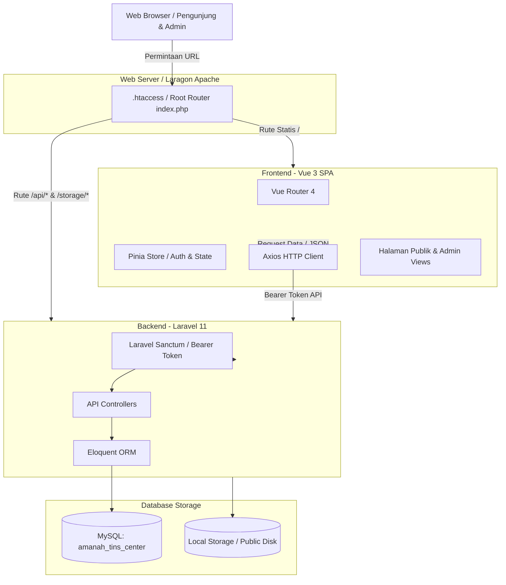
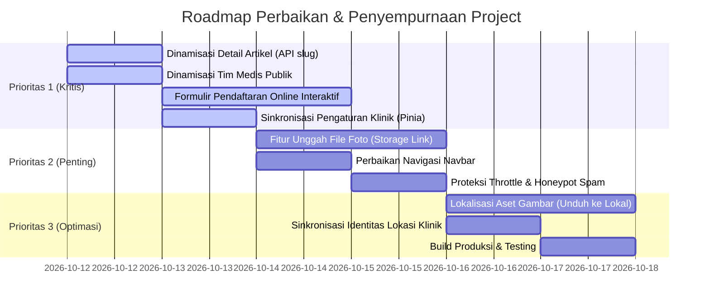

# Laporan Analisis, Arsitektur, dan Rekomendasi Project
## Amanah Tin's Center - Website & Sistem Informasi Klinik Tumbuh Kembang Anak

---

## Daftar Isi
1. [Ringkasan Eksekutif](#1-ringkasan-eksekutif)
2. [Arsitektur & Tumpukan Teknologi](#2-arsitektur--tumpukan-teknologi)
3. [Daftar Modul & Fitur Terpasang](#3-daftar-modul--fitur-terpasang)
   - [3.1 Halaman Publik (Orang Tua & Pengunjung)](#31-halaman-publik-orang-tua--pengunjung)
   - [3.2 Portal Administrasi (Admin & Terapis)](#32-portal-administrasi-admin--terapis)
   - [3.3 Backend API & Skema Database](#33-backend-api--skema-database)
4. [Analisis Kekurangan & Masalah Kritis](#4-analisis-kekurangan--masalah-kritis)
   - [4.1 Integrasi Data Frontend Masih Parsial (Data Hardcoded)](#41-integrasi-data-frontend-masih-parsial-data-hardcoded)
   - [4.2 Formulir Booking Publik Belum Tersimpan ke Database](#42-formulir-booking-publik-belum-tersimpan-ke-database)
   - [4.3 Konflik Navigasi Navbar pada Halaman Beranda](#43-konflik-navigasi-navbar-pada-halaman-beranda)
   - [4.4 Inkonsistensi Identitas Lokasi Klinik](#44-inkonsistensi-identitas-lokasi-klinik)
   - [4.5 Ketiadaan Fitur Unggah Berkas Langsung (File Upload)](#45-ketiadaan-fitur-unggah-berkas-langsung-file-upload)
   - [4.6 Aspek Keamanan & Rate Limiting](#46-aspek-keamanan--rate-limiting)
   - [4.7 Risiko Ketergantungan URL Gambar Eksternal](#47-risiko-ketergantungan-url-gambar-eksternal)
   - [4.8 Kesiapan Lingkungan & Konfigurasi Produksi](#48-kesiapan-lingkungan--konfigurasi-produksi)
5. [Rencana Aksi & Rekomendasi Solusi Konkret](#5-rencana-aksi--rekomendasi-solusi-konkret)
6. [Panduan Operasional & Menjalankan Sistem](#6-panduan-operasional--menjalankan-sistem)

---

## 1. Ringkasan Eksekutif

**Amanah Tin's Center (ATC)** adalah aplikasi web dan sistem informasi klinik tumbuh kembang anak terpadu yang melayani terapi spesialisasi anak, meliputi:
- **Terapi Wicara (TW)**
- **Terapi Okupasi (TO)**
- **Sensori Integrasi (SI)**
- **Psikologi Anak / Fisioterapi Pediatrik**

Aplikasi ini menggabungkan antarmuka **Frontend SPA (Single Page Application)** berestetika tinggi bertema *"Warm Child Development Sanctuary"* (pendekatan ramah anak, warna teals, sage, amber, font *Outfit* dan *Nunito Sans*) dengan **Backend Laravel 11** berbasis RESTful API dan basis data MySQL.

Aset visual dan desain halaman berakar dari cetak biru antarmuka di folder [stitch_blueprint_website_implementation](file:///c:/laragon/www/AmanahTinsCenter/stitch_blueprint_website_implementation).

---

## 2. Arsitektur & Tumpukan Teknologi

### Diagram Arsitektur Sistem



### Spesifikasi Tumpukan Teknologi:
- **Frontend**:
  - [Vue 3](https://vuejs.org/) (Composition API, `<script setup>`)
  - [Vite 8](https://vitejs.dev/) (Bundler performa tinggi)
  - [Vue Router 4](https://router.vuejs.org/) (SPA routing dengan *Auth Guard* di [router/index.js](file:///c:/laragon/www/AmanahTinsCenter/frontend/src/router/index.js))
  - [Pinia](https://pinia.vuejs.org/) (State management untuk sesi admin di [stores/auth.js](file:///c:/laragon/www/AmanahTinsCenter/frontend/src/stores/auth.js))
  - [Axios](https://axios-http.com/) (HTTP Client dengan Interceptor Token di [services/api.js](file:///c:/laragon/www/AmanahTinsCenter/frontend/src/services/api.js))
  - Google Fonts (*Outfit* untuk display & headline, *Nunito Sans* untuk body) & Material Symbols Outlined
- **Backend**:
  - [Laravel 11](https://laravel.com/) (RESTful API architecture)
  - [Laravel Sanctum](https://laravel.com/docs/sanctum) (Otentikasi token API)
  - [MySQL 8.0](https://www.mysql.com/)
  - Eloquent ORM, Database Migrations, & Seeders
- **Integrasi Server**:
  - [index.php](file:///c:/laragon/www/AmanahTinsCenter/index.php) & [.htaccess](file:///c:/laragon/www/AmanahTinsCenter/.htaccess) sebagai router universal untuk integrasi Apache Laragon.

---

## 3. Daftar Modul & Fitur Terpasang

### 3.1 Halaman Publik (Orang Tua & Pengunjung)

| Rute URL | Komponen Vue | Deskripsi & Komponen Fitur |
| :--- | :--- | :--- |
| `/` | [HomeView.vue](file:///c:/laragon/www/AmanahTinsCenter/frontend/src/views/HomeView.vue) | Beranda utama: Hero section, 4 pilar terapi, profil pendiri (Bpk. Artin Ristriawan & Ibu Hertin Nurfarida), showcase 4 layanan, tim terapis, daftar artikel edukasi terbaru, 3 alur pendaftaran, dan informasi kontak/lokasi klinik. |
| `/tentang-kami` | [AboutView.vue](file:///c:/laragon/www/AmanahTinsCenter/frontend/src/views/AboutView.vue) | Visi, misi, nilai budaya klinik, sejarah pendirian, galeri fasilitas ramah anak, dan komitmen profesional berstandar klinis. |
| `/layanan` | [ServicesView.vue](file:///c:/laragon/www/AmanahTinsCenter/frontend/src/views/ServicesView.vue) | Katalog program terapi: Terapi Wicara, Terapi Okupasi, Sensori Integrasi, dan Fisioterapi Pediatrik / Psikologi Anak. |
| `/layanan/:slug` | [ServiceDetailView.vue](file:///c:/laragon/www/AmanahTinsCenter/frontend/src/views/ServiceDetailView.vue) | Rincian lengkap indikasi keterlambatan anak, durasi, pendekatan, tahapan asesmen awal, rincian 3 paket biaya terapi, dan FAQ interaktif. |
| `/tim-kami` | [TeamView.vue](file:///c:/laragon/www/AmanahTinsCenter/frontend/src/views/TeamView.vue) | Profil tenaga medis & terapis berizin STR Kemenkes dengan foto, spesialisasi, dan fokus intervensi. |
| `/artikel` | [ArticlesView.vue](file:///c:/laragon/www/AmanahTinsCenter/frontend/src/views/ArticlesView.vue) | Portal edukasi tumbuh kembang anak dengan filter kategori topik interaktif dan fitur pencarian kata kunci (*live search*). |
| `/artikel/:slug` | [ArticleDetailView.vue](file:///c:/laragon/www/AmanahTinsCenter/frontend/src/views/ArticleDetailView.vue) | Pembaca artikel komprehensif, dokter reviewer medis, estimasi waktu baca, counter pembaca, tombol bookmark, dan rekomendasi artikel terkait. |
| `/jadwal-pendaftaran` | [ScheduleView.vue](file:///c:/laragon/www/AmanahTinsCenter/frontend/src/views/ScheduleView.vue) | Panduan langkah reservasi, jam operasional, dan kanal konsultasi langsung ke klinik. |

### 3.2 Portal Administrasi (Admin & Terapis)

| Rute URL | Komponen Vue | Deskripsi & Komponen Fitur |
| :--- | :--- | :--- |
| `/admin/login` | [LoginView.vue](file:///c:/laragon/www/AmanahTinsCenter/frontend/src/views/admin/LoginView.vue) | Autentikasi split-screen dengan autofill kredensial demo (`admin@amanahtinscenter.com` / `admin123`). |
| `/admin/dashboard` | [DashboardView.vue](file:///c:/laragon/www/AmanahTinsCenter/frontend/src/views/admin/DashboardView.vue) | Statistik metrik *real-time* (total janji temu, janji menunggu, terapis aktif, artikel terbit, total pembaca), tabel 5 janji terbaru, dan shortcut aksi cepat. |
| `/admin/jadwal` | [ScheduleView.vue](file:///c:/laragon/www/AmanahTinsCenter/frontend/src/views/admin/ScheduleView.vue) | Manajemen janji konsultasi, filter status (Pending, Confirmed, Completed, Cancelled), tombol langsung direct-chat WhatsApp ke nomor orang tua, modal update status & catatan admin, serta hapus data. |
| `/admin/artikel` | [ArticlesView.vue](file:///c:/laragon/www/AmanahTinsCenter/frontend/src/views/admin/ArticlesView.vue) | Pengelolaan artikel edukasi, filter kategori, status terbit vs draf, pencarian, dan hapus artikel. |
| `/admin/artikel/baru` | [ArticleFormView.vue](file:///c:/laragon/www/AmanahTinsCenter/frontend/src/views/admin/ArticleFormView.vue) | Form pembuatan artikel baru dengan toolbar tag HTML, pratinjau gambar sampul, metadata kategori, dan saklar draf/publikasi. |
| `/admin/artikel/:id/edit` | [ArticleFormView.vue](file:///c:/laragon/www/AmanahTinsCenter/frontend/src/views/admin/ArticleFormView.vue) | Mode edit artikel untuk memperbarui konten dan metadata artikel yang ada. |
| `/admin/tim-kami` | [TeamView.vue](file:///c:/laragon/www/AmanahTinsCenter/frontend/src/views/admin/TeamView.vue) | Manajemen tenaga medis, modal tambah & edit terapis, keahlian, sertifikasi, urutan penampilan, dan status keaktifan. |
| `/admin/pengaturan` | [SettingsView.vue](file:///c:/laragon/www/AmanahTinsCenter/frontend/src/views/admin/SettingsView.vue) | Konfigurasi profil resmi klinik, nomor WhatsApp pendaftaran, jam operasional hari kerja & akhir pekan, serta media sosial. |

### 3.3 Backend API & Skema Database

Diatur pada [routes/api.php](file:///c:/laragon/www/AmanahTinsCenter/backend/routes/api.php) dengan tabel-tabel utama:
1. **`users`**: Kredensial administrator klinik (nama, email, password terenkripsi bcrypt).
2. **`articles`**: Materi literasi anak (`title`, `slug`, `category`, `excerpt`, `content`, `author`, `image`, `read_time`, `is_published`, `views_count`).
3. **`team_members`**: Profil tim terapis (`name`, `role`, `specialization`, `bio`, `experience_years`, `certifications`, `image`, `order`, `is_active`).
4. **`appointments`**: Data pendaftaran janji temu (`parent_name`, `child_name`, `child_age`, `phone`, `email`, `service_type`, `preferred_date`, `preferred_time`, `notes`, `status`, `admin_notes`).
5. **`clinic_settings`**: Informasi resmi profil klinik (`clinic_name`, `tagline`, `phone`, `whatsapp`, `email`, `address`, `maps_url`, `weekday_hours`, `weekend_hours`, `instagram`, `facebook`, `youtube`, `about_summary`).
6. **`personal_access_tokens`**: Token otentikasi Sanctum untuk sesi login admin.

---

## 4. Analisis Kekurangan & Masalah Kritis

> [!WARNING]
> Bagian ini memuat temuan teknis yang memerlukan perhatian sebelum sistem dioperasikan secara penuh di lingkungan produksi.

### 4.1 Integrasi Data Frontend Masih Parsial (Data Hardcoded)

Walaupun backend API sudah lengkap, sebagian halaman frontend publik masih menggunakan data tiruan (*mock*) atau statis:

1. **Halaman Pembaca Artikel ([ArticleDetailView.vue](file:///c:/laragon/www/AmanahTinsCenter/frontend/src/views/ArticleDetailView.vue))**:
   - Komponen ini bersifat **statis penuh** dan tidak membaca parameter URL `slug`.
   - Tidak ada pemanggilan API `GET /api/articles/{slug}`.
   - Apapun judul artikel yang diklik oleh pengunjung dari daftar artikel, tampilan yang muncul akan selalu sama persis (*"Tanda-Tanda Anak Membutuhkan Terapi Wicara"* oleh Nabila Maharani).
   - Artikel baru yang ditulis admin tidak akan pernah bisa dibaca isinya oleh publik.
2. **Halaman Tim Medis Publik ([TeamView.vue:L164-189](file:///c:/laragon/www/AmanahTinsCenter/frontend/src/views/TeamView.vue#L164-L189))**:
   - Terdapat `import api from '../services/api'`, namun **tidak pernah dipanggil**.
   - Daftar 12 anggota tim ditulis statis di dalam kode script.
   - Penambahan atau pengeditan data terapis di portal admin tidak akan tercermin pada halaman publik.
3. **Pengaturan Informasi Kontak ([TheFooter.vue](file:///c:/laragon/www/AmanahTinsCenter/frontend/src/components/TheFooter.vue), [ScheduleView.vue](file:///c:/laragon/www/AmanahTinsCenter/frontend/src/views/ScheduleView.vue), [HomeView.vue](file:///c:/laragon/www/AmanahTinsCenter/frontend/src/views/HomeView.vue))**:
   - Endpoint `GET /api/settings` hanya dipanggil di halaman admin setting.
   - Nomor WhatsApp, telepon, dan alamat pada footer, beranda, dan halaman pendaftaran ditulis secara statis (hardcoded).
   - Perubahan nomor WhatsApp di menu admin pengaturan tidak akan mengubah nomor tujuan WhatsApp di situs publik.
4. **Bug Pemanggilan Thumbnail Artikel ([ArticlesView.vue:L85](file:///c:/laragon/www/AmanahTinsCenter/frontend/src/views/ArticlesView.vue#L85))**:
   - Frontend memanggil atribut `article.thumbnail`, padahal field kolom database Laravel adalah `image`.
   - Hal ini menyebabkan artikel yang berasal dari database selalu memuat gambar placeholder `placehold.co`.
5. **Logika Minimal Artikel di Beranda ([HomeView.vue:L616](file:///c:/laragon/www/AmanahTinsCenter/frontend/src/views/HomeView.vue#L616))**:
   - Terdapat kondisi `if (res.data.data.length >= 4)`. Jika artikel di database baru ada 1–3 artikel, sistem mengabaikannya dan tetap menampilkan data tiruan (*blueprintArticles*).

---

### 4.2 Formulir Booking Publik Belum Tersimpan ke Database

- Backend telah memiliki endpoint `POST /api/appointments` yang tervalidasi dengan baik.
- Di sisi admin juga telah tersedia antarmuka manajemen janji temu ([admin/ScheduleView.vue](file:///c:/laragon/www/AmanahTinsCenter/frontend/src/views/admin/ScheduleView.vue)).
- Namun pada halaman publik ([ScheduleView.vue](file:///c:/laragon/www/AmanahTinsCenter/frontend/src/views/ScheduleView.vue) dan [HomeView.vue](file:///c:/laragon/www/AmanahTinsCenter/frontend/src/views/HomeView.vue)), tombol pendaftaran hanya berupa tautan direct ke WhatsApp (`https://wa.me/6281234567890`), tanpa ada form input langsung.
- **Dampak**: Data janji temu dari website tidak tersimpan ke database klinik. Tabel janji temu admin hanya akan berisi data bawaan dari seeder.

---

### 4.3 Konflik Navigasi Navbar pada Halaman Beranda

- Pada [TheNavbar.vue:L76-92](file:///c:/laragon/www/AmanahTinsCenter/frontend/src/components/TheNavbar.vue#L76-L92):
  ```javascript
  if (route.path === '/') {
    e.preventDefault()
    // scroll to #section-id
  }
  ```
- Ketika pengunjung sedang membuka Beranda (`/`), mengklik menu *"Tentang Kami"*, *"Layanan"*, atau *"Tim Kami"* di navbar akan dicegat oleh `e.preventDefault()` untuk melakukan *scroll* ke section terkait di halaman beranda.
- **Dampak**: Pengunjung yang berada di beranda kesulitan membuka halaman penuh `/tentang-kami`, `/layanan`, atau `/tim-kami` melalui menu navigasi atas.

---

### 4.4 Inkonsistensi Identitas Lokasi Klinik

Terdapat perbedaan data identitas klinik antara backend dan frontend:
- **Di Database Seeder ([DatabaseSeeder.php:L38](file:///c:/laragon/www/AmanahTinsCenter/backend/database/seeders/DatabaseSeeder.php#L38))**:
  - Alamat: *Jl. Jenderal Sudirman No. 88, Pangkalpinang, Bangka Belitung*
  - Telepon: `+62 717 9101234`
  - WhatsApp: `6282188899900`
- **Di Antarmuka Frontend ([HomeView.vue](file:///c:/laragon/www/AmanahTinsCenter/frontend/src/views/HomeView.vue), [TheFooter.vue](file:///c:/laragon/www/AmanahTinsCenter/frontend/src/components/TheFooter.vue), [ScheduleView.vue](file:///c:/laragon/www/AmanahTinsCenter/frontend/src/views/ScheduleView.vue))**:
  - Alamat: *Jl. Raya Jagakarsa No. 12, Jagakarsa, Jakarta Selatan*
  - Telepon: `(021) 1234 5678`
  - WhatsApp: `0812-3456-7890`

---

### 4.5 Ketiadaan Fitur Unggah Berkas Langsung (File Upload)

- Pada form artikel ([ArticleFormView.vue](file:///c:/laragon/www/AmanahTinsCenter/frontend/src/views/admin/ArticleFormView.vue)) dan form tim medis, input foto hanya berupa teks URL (`<input type="url">`).
- Backend belum menyediakan endpoint upload multipart (`Storage::disk('public')->putFile(...)`).
- **Dampak**: Admin harus mengunggah foto ke layanan eksternal terlebih dahulu (seperti Imgur, Cloudinary, atau hosting lain) lalu menyalin tautannya.

---

### 4.6 Aspek Keamanan & Rate Limiting

1. **Brute Force Login**: Endpoint `POST /api/auth/login` belum memiliki middleware `throttle:5,1`. Penyerang dapat melakukan percobaan login berulang tanpa batasan frekuensi.
2. **Spam Form Janji Temu**: Endpoint `POST /api/appointments` belum memiliki *rate limiting*, proteksi reCAPTCHA, atau field honeypot.
3. **Penyimpanan Token**: Token disimpan di `localStorage` (`atc_admin_token`). Untuk aplikasi dengan data medis/pendaftaran anak, disarankan menggunakan *HttpOnly Cookie* untuk mitigasi XSS.
4. **Bocornya Draf Artikel**: Pada [ArticleController.php:L36](file:///c:/laragon/www/AmanahTinsCenter/backend/app/Http/Controllers/Api/ArticleController.php#L36), method `show($slug)` tidak menyertakan filter `where('is_published', true)`. Siapapun yang mengetahui slug artikel draft dapat membaca konten yang belum resmi dirilis.

---

### 4.7 Risiko Ketergantungan URL Gambar Eksternal

- Aset gambar tim terapis, ilustrasi artikel, dan foto profil banyak menggunakan URL Google-hosted (`https://lh3.googleusercontent.com/aida-public/...`).
- URL tersebut berpotensi mengalami *expired* atau *403 Forbidden* sewaktu-waktu, yang dapat mengakibatkan gambar di situs pecah (broken image).

---

### 4.8 Kesiapan Lingkungan & Konfigurasi Produksi

- File konfigurasi `.env` pada folder `backend` belum dibuat (hanya ada `.env.example`).
- Folder kompilasi `frontend/dist` belum digenerate melalui `npm run build`.
- Router fallback di [index.php:L51](file:///c:/laragon/www/AmanahTinsCenter/index.php#L51) akan memunculkan teks *"Amanah Tin's Center - Sedang mempersiapkan frontend..."* jika folder `frontend/dist` belum dikompilasi saat diakses via Laragon.

---

## 5. Rencana Aksi & Rekomendasi Solusi Konkret

Berikut matriks prioritas perbaikan yang direkomendasikan:



### Rekomendasi Langkah Teknis:

#### 1. Dinamisasi Detail Artikel ([ArticleDetailView.vue](file:///c:/laragon/www/AmanahTinsCenter/frontend/src/views/ArticleDetailView.vue))
- Gunakan `useRoute()` untuk menangkap parameter:
  ```javascript
  import { useRoute } from 'vue-router'
  import api from '../services/api'
  
  const route = useRoute()
  const article = ref(null)
  const loading = ref(true)

  onMounted(async () => {
    try {
      const res = await api.get(`/articles/${route.params.slug}`)
      article.value = res.data.article
      displayRelated.value = res.data.related || []
    } finally {
      loading.value = false
    }
  })
  ```
- Render judul, penulis, tanggal, dan isi konten menggunakan `v-html="article.content"`.

#### 2. Hadirkan Form Pendaftaran Interaktif di [ScheduleView.vue](file:///c:/laragon/www/AmanahTinsCenter/frontend/src/views/ScheduleView.vue)
- Sediakan formulir digital dengan field:
  - Nama Lengkap Orang Tua
  - Nama Panggilan / Lengkap Anak & Usia
  - Nomor Telepon / WhatsApp
  - Pilihan Program Terapi (TW, TO, SI, Psikologi Anak)
  - Pilihan Tanggal & Waktu Sesi
  - Catatan Keluhan Perkembangan Anak
- Kirimkan data ke `POST /api/appointments`.
- Setelah sukses tersimpan, tampilkan konfirmasi berhasil beserta tombol menuju WhatsApp dengan *pre-filled text* agar orang tua dapat langsung mengonfirmasi jadwal ke admin.

#### 3. Sentralisasi Pengaturan Profil Klinik (Pinia Store)
- Buat store `useClinicStore` di `frontend/src/stores/clinic.js` yang memanggil `GET /api/settings`.
- Hubungkan data nomor WhatsApp, telepon, jam buka, dan alamat pada [TheNavbar.vue](file:///c:/laragon/www/AmanahTinsCenter/frontend/src/components/TheNavbar.vue), [TheFooter.vue](file:///c:/laragon/www/AmanahTinsCenter/frontend/src/components/TheFooter.vue), dan tombol *Floating WhatsApp* ke store tersebut.

#### 4. Penambahan Fitur Upload File (Media Controller)
- Di backend, buat controller untuk menerima unggahan gambar:
  ```php
  public function upload(Request $request) {
      $request->validate(['file' => 'required|image|max:2048']);
      $path = $request->file('file')->store('uploads', 'public');
      return response()->json(['url' => asset('storage/' . $path)]);
  }
  ```
- Jalankan perintah symlink storage:
  ```bash
  php artisan storage:link
  ```
- Di frontend, tambahkan elemen `<input type="file" @change="onFileSelected">` di samping input URL.

#### 5. Penguatan Keamanan (Security Hardening)
- Pada [routes/api.php](file:///c:/laragon/www/AmanahTinsCenter/backend/routes/api.php), tambahkan middleware rate limiting:
  ```php
  Route::post('/auth/login', [AuthController::class, 'login'])->middleware('throttle:5,1');
  Route::post('/appointments', [AppointmentController::class, 'store'])->middleware('throttle:10,1');
  ```
- Pada [ArticleController.php](file:///c:/laragon/www/AmanahTinsCenter/backend/app/Http/Controllers/Api/ArticleController.php), pastikan query show hanya menampilkan artikel terbit:
  ```php
  $article = Article::where('slug', $slug)->where('is_published', true)->firstOrFail();
  ```

---

## 6. Panduan Operasional & Menjalankan Sistem

### Persyaratan Sistem:
- **Laragon**: Apache / Nginx aktif dan MySQL running
- **PHP**: Versi >= 8.2 (Terinstal di sistem: PHP 8.4)
- **Node.js**: Versi >= 18.x dan npm

### Langkah Menjalankan:

#### 1. Inisialisasi Backend Laravel
Buka terminal pada direktori backend:
```bash
cd c:\laragon\www\AmanahTinsCenter\backend

# 1. Salin konfigurasi environment jika belum ada
cp .env.example .env

# 2. Buat application key
php artisan key:generate

# 3. Buat symlink public storage
php artisan storage:link

# 4. Jalankan migrasi dan seeder database
php artisan migrate:fresh --seed

# 5. Jalankan server API (default port 8000)
php artisan serve
```
Backend API berjalan di: **`http://localhost:8000`**

#### 2. Menjalankan Frontend Vue.js (Mode Pengembangan)
Buka terminal baru pada direktori frontend:
```bash
cd c:\laragon\www\AmanahTinsCenter\frontend

# 1. Pastikan dependencies terinstal
npm install

# 2. Jalankan server pengembangan Vite
npm run dev
```
Frontend Vue.js berjalan di: **`http://localhost:5173`**

#### 3. Build Produksi (Untuk Akses via Domain Lokal Laragon)
Agar project dapat dibuka langsung melalui URL Laragon (`http://amanahtinscenter.test` atau `http://localhost/AmanahTinsCenter`), jalankan kompilasi:
```bash
cd c:\laragon\www\AmanahTinsCenter\frontend
npm run build
```
File hasil kompilasi akan otomatis disimpan di `frontend/dist/` dan siap dilayani oleh [index.php](file:///c:/laragon/www/AmanahTinsCenter/index.php) dan [.htaccess](file:///c:/laragon/www/AmanahTinsCenter/.htaccess) di root project.

---

### Kredensial Administrator Bawaan:
- **URL Login Admin:** `http://localhost:5173/admin/login` (atau `/admin/login`)
- **Email:** `admin@amanahtinscenter.com`
- **Kata Sandi:** `admin123`
