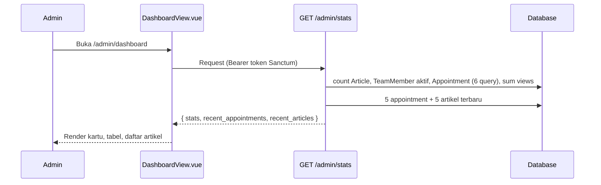

# Dokumentasi Halaman Dashboard Admin
**Amanah Tin's Center** — revisi (alur "Janji & Pendaftaran" dinonaktifkan, pendaftaran via WhatsApp)

| Item | Detail |
|---|---|
| Rute | `/admin/dashboard` (menu sidebar: "Dashboard Ringkasan") |
| Frontend | `frontend/src/views/admin/DashboardView.vue` (Vue 3, `<script setup>`) |
| Layout | `frontend/src/layouts/AdminLayout.vue` (sidebar + topbar + slot konten) |
| Backend | `backend/app/Http/Controllers/Api/DashboardController.php` → `stats()` |
| Endpoint | `GET /api/admin/stats` (Laravel Sanctum) |
| Akses | Admin yang sudah login |

---

## 1. Konteks Perubahan Alur
Di **halaman publik**, konsultasi dan pendaftaran terapi tidak lagi memakai formulir yang tersimpan ke database. Semua tombol (Beranda, Layanan, Detail Layanan, Tim, Artikel, Jadwal & Pendaftaran) mengarah langsung ke **WhatsApp klinik** (`wa.me/...`). Bahkan form singkat di `ServiceDetailView` hanya menyusun teks lalu membuka `wa.me`, tanpa memanggil API.

**Akibatnya**, fitur berbasis tabel `appointments` di admin (menu "Janji & Pendaftaran", `/admin/jadwal`) tidak lagi mendapat data baru dan sebaiknya dinonaktifkan. Dashboard saat ini masih sangat bergantung pada fitur itu, sehingga **sebagian besar kontennya perlu disesuaikan** (lihat bagian 4).

## 2. Tujuan Halaman (setelah penyesuaian)
Ringkasan konten klinik yang dikelola admin: artikel/edukasi, tim terapis, dan pengaturan klinik (termasuk nomor WhatsApp pendaftaran), plus pintasan ke tugas yang sering dilakukan.

## 3. Struktur Halaman Saat Ini (kondisi kode sekarang)

### 3.1 Kerangka (AdminLayout)
- **Sidebar**: brand "Portal Admin & Terapis", status "Sistem Terhubung" (statis), menu: Dashboard Ringkasan, **Janji & Pendaftaran**, Kelola Artikel & Tips, Kelola Tim Terapis, Pengaturan Klinik, tautan "Tinjau Website Utama", profil pengguna + tombol keluar. Sidebar dapat dilipat.
- **Topbar**: breadcrumb "Admin Portal > Dashboard Ringkasan", badge "MySQL Terhubung" (statis), tombol **"Form Pasien Baru"** yang membuka `/jadwal-pendaftaran` (halaman publik, bukan form; sekarang hanya halaman info + WhatsApp).

### 3.2 Banner Selamat Datang
- Sapaan `Selamat Datang, {auth.user.name}` (fallback "Administrator"), chip "Pusat Kendali Administrasi".
- Teks mengatakan memantau "pendaftaran janji terapi ... real-time".
- Tombol **Lihat Semua Janji** → `/admin/jadwal`.

### 3.3 Empat Kartu Statistik
| Kartu | Sumber | Status setelah perubahan alur |
|---|---|---|
| Total Pendaftaran Terapi (+ badge "N Menunggu") | `total_appointments`, `pending_appointments` | **Tidak relevan**: akan stagnan di angka lama/0 |
| Terapis Medis Terdaftar (badge "4 Layanan Utama" statis) | `TeamMember` aktif | Relevan |
| Artikel & Tips Diterbitkan (badge statis) | `Article::count()` | Relevan (perlu hitung hanya published) |
| Total Pembaca Artikel (badge statis) | `Article::sum(views_count)` | Relevan |

### 3.4 Tabel "Pendaftaran Janji Temu Terbaru"
- 5 janji terakhir; kolom pasien/orang tua, layanan, jadwal, status, aksi.
- Aksi: konfirmasi cepat (`PUT /admin/appointments/{id}`) dan tombol WhatsApp ke orang tua.
- **Tidak relevan lagi**: tabel akan kosong ("Belum ada janji temu...") atau berisi data lama saja.

### 3.5 Panel Kanan
- **Aksi Cepat**: Tulis Artikel Baru, Tambah Terapis, Konfigurasi Klinik. (Relevan)
- **Artikel Terbaru**: 5 artikel terakhir, thumbnail, kategori, judul (link edit), jumlah dilihat, penulis. (Relevan)

### 3.6 Alur Data


## 4. Dampak Penonaktifan "Janji & Pendaftaran" pada Dashboard

| Bagian | Masalah | Rekomendasi |
|---|---|---|
| Menu sidebar "Janji & Pendaftaran" | Mengarah ke fitur tak terpakai | Sembunyikan/hapus (komentar `router-link`) atau beri label "Arsip" |
| Tombol "Lihat Semua Janji" di banner | Mengarah ke halaman nonaktif | Ganti ke "Tulis Artikel Baru" atau "Pengaturan WhatsApp" |
| Teks banner ("pendaftaran janji terapi") | Menyesatkan | Ubah: "Kelola artikel edukasi, tim terapis, dan kontak klinik" |
| Kartu "Total Pendaftaran Terapi" | Angka usang | Hapus; ganti kartu lain (lihat saran) |
| Tabel janji temu terbaru | Kosong/usang | Hapus; ganti widget baru |
| Fungsi `quickUpdateStatus`, `cleanPhone`, `getStatusClass/Label`, `formatDate` | Kode mati | Hapus setelah tabel dihapus |
| Topbar "Form Pasien Baru" | Nama menjebak; tidak ada form | Ubah jadi "Buka WhatsApp Klinik" atau "Lihat Halaman Pendaftaran" |
| API `/admin/stats` (6 query appointment) | Query tak perlu | Hapus field appointment dari `DashboardController` |
| Route `/admin/appointments*` & `AppointmentController` | Masih aktif tanpa dipakai | Nonaktifkan atau pertahankan hanya baca (arsip) |
| Badge "Sistem Terhubung" & "MySQL Terhubung" | Statis, bukan status nyata | Hubungkan ke health-check atau hapus |

> [!NOTE]
> Disarankan **menonaktifkan, bukan menghapus tabel** `appointments`, agar data historis tetap aman dan fitur bisa diaktifkan lagi.

## 5. Rancangan Dashboard yang Disarankan

**Kartu statistik baru (4):**
1. Artikel Terbit (dan jumlah draft sebagai sub-teks).
2. Terapis Aktif.
3. Total Pembaca Artikel (+ tren 7 hari bila ada pencatatan).
4. **Kontak WhatsApp Klinik** (nomor aktif dari Pengaturan, tombol "Ubah") — karena WhatsApp sekarang jadi jalur utama pendaftaran.

**Widget konten:**
- **Artikel Terpopuler** (urut `views_count`) di samping "Artikel Terbaru".
- **Kesehatan Konten**: artikel draft belum terbit, artikel tanpa gambar, terapis tanpa foto/bio.
- **Aksi Cepat**: Tulis Artikel, Tambah Terapis, Ubah Nomor WhatsApp & Jam Operasional, Tinjau Website.
- **Tes tautan WhatsApp**: tombol "Uji Chat" yang membuka `wa.me/{nomor}` dengan pesan contoh.
- **Pengingat kelengkapan pengaturan**: peringatan jika nomor WA, alamat, atau jam operasional kosong.

## 6. Kekurangan (diperbarui)

| # | Kekurangan | Prioritas |
|---|---|---|
| 1 | Banyak elemen merujuk fitur nonaktif (menu, banner, kartu, tabel, tombol topbar) | Tinggi |
| 2 | Nomor WhatsApp **hardcoded** `6281234567890` di banyak halaman publik, sementara `HomeView` memakai nilai dari Pengaturan → admin mengubah nomor di Pengaturan tetapi sebagian halaman tidak ikut berubah | **Tinggi** |
| 3 | Error loading hanya `console.error`; kartu menampilkan 0 | Tinggi |
| 4 | Badge statis ("4 Layanan Utama", "Edukasi Ortu", "Interaksi") | Tinggi |
| 5 | "Artikel Diterbitkan" menghitung draft juga | Tinggi |
| 6 | Klaim "real-time" tidak benar (sekali muat) | Sedang |
| 7 | Tidak ada skeleton loading untuk kartu & artikel | Sedang |
| 8 | Query statistik tak efisien, tanpa cache | Sedang |
| 9 | Tidak ada grafik (mis. pembaca artikel per hari) | Sedang |
| 10 | Gambar fallback Unsplash eksternal, `alt` kosong | Rendah |
| 11 | Tombol ikon tanpa `aria-label` | Rendah |
| 12 | Badge status sistem di layout statis | Rendah |

## 7. Saran Perbaikan (urutan pengerjaan)
1. **Rapikan dashboard**: hapus kartu/tabel appointment, ubah teks banner dan tombol, nonaktifkan menu "Janji & Pendaftaran" dan tombol topbar "Form Pasien Baru".
2. **Sentralisasi nomor WhatsApp**: buat store/composable (mis. `useClinicSettings`) yang mengambil `whatsapp` dari `/settings` sekali, dipakai semua halaman publik; hapus semua `6281234567890` hardcoded. Ini menjadikan menu Pengaturan benar-benar berfungsi.
3. **Perbarui `DashboardController`**: hapus query appointment; tambahkan `published_articles`, `draft_articles`, `popular_articles`; gunakan `Cache::remember`.
4. Tambahkan **error state + toast** dan skeleton loader.
5. Tambahkan widget **Kesehatan Konten** dan peringatan kelengkapan Pengaturan.
6. (Opsional) Grafik tren pembaca, dan pencatatan klik tombol WhatsApp (mis. event sederhana ke backend) agar admin tahu minat per layanan karena pendaftaran tidak lagi tercatat di sistem.

Contoh `DashboardController` setelah penyesuaian:
```php
public function stats()
{
    return response()->json([
        'stats' => [
            'published_articles' => Article::where('status', 'published')->count(),
            'draft_articles'     => Article::where('status', 'draft')->count(),
            'total_team'         => TeamMember::where('is_active', true)->count(),
            'total_views'        => Article::sum('views_count'),
        ],
        'popular_articles' => Article::orderByDesc('views_count')->limit(5)->get(),
        'recent_articles'  => Article::latest()->limit(5)->get(),
    ]);
}
```
*(Sesuaikan nama kolom `status` dengan skema tabel `articles` yang sebenarnya.)*

## 8. Kesimpulan
Setelah pendaftaran dialihkan penuh ke WhatsApp, dashboard admin sebaiknya berubah dari "pusat pemantauan janji temu" menjadi "pusat pengelolaan konten dan kontak klinik". Hal terpenting: bersihkan elemen appointment dan pastikan **satu sumber nomor WhatsApp** dari Pengaturan dipakai di seluruh situs.
